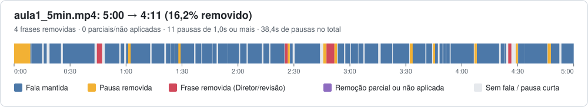
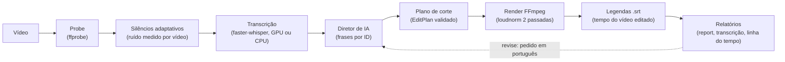
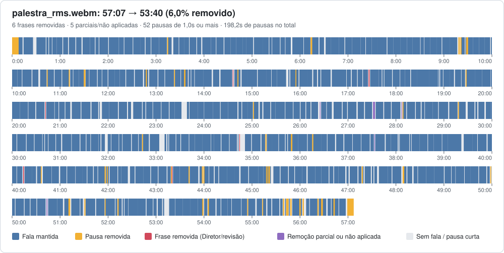

# AI Video Editor

**Editor de vídeo com IA que remove pausas, repetições e enrolação de aulas e tutoriais — e explica cada corte.**

[](https://github.com/vitaoooooo/ai-video-editor/actions/workflows/tests.yml)


| Aula do MIT (5 min) | Palestra (57 min) | Testes automatizados |
| --- | --- | --- |
| **5:00 → 4:11** (−16,2%), processada em 1min 05s | **57:07 → 53:40** (−6,0%), 259 cortes | **413**, sem rede, com vídeos sintéticos |



*Linha do tempo gerada pelo próprio editor (`edit_timeline.svg`): azul é a fala mantida, amarelo as pausas removidas, vermelho as frases que o Diretor de IA removeu.*

---

## O problema e a solução

Gravar uma aula ou um tutorial é rápido; editar não é. Boa parte do trabalho é mecânica: tirar silêncios, frases recomeçadas ("Let me, I can even say right away…"), repetições e muletas. Ferramentas de "corte de silêncio" resolvem só a primeira parte, e editores com IA costumam cortar sem dizer o quê nem por quê.

Este projeto faz as duas coisas e mostra o trabalho: mede as pausas no áudio, transcreve, deixa um modelo de linguagem decidir quais **frases** saem (com categoria e motivo), renderiza com FFmpeg e entrega relatórios que dizem exatamente o que saiu, o que ficou e se cada corte pedido foi de fato aplicado. Depois, dá para pedir ajustes em português ("corta menos") e cada pedido vira uma nova versão.

## Como funciona



**A regra de ouro: a IA decide, o FFmpeg executa.** O modelo nunca corta o vídeo. Ele devolve dados estruturados (validados com Pydantic) e um motor determinístico transforma isso em comandos FFmpeg. Uma resposta inválida da IA é recusada, devolvida ao modelo com o erro e, se falhar de novo, o vídeo sai só com o corte de silêncio; o vídeo nunca fica corrompido por uma decisão ruim.

**Por que a IA aponta frases pelo número, nunca por timestamps.** O Diretor recebe a transcrição como uma lista numerada de frases e responde "remova a 5, a 22 e a 25, por estes motivos". Os tempos ficam com o código, por dois motivos: modelos de linguagem inventam números com facilidade, e os tempos de palavra do Whisper não são confiáveis (ele estica palavras para dentro das pausas). Então os limites de cada corte são ajustados para dentro do silêncio medido mais próximo, e uma regra garante que nunca sobre meia palavra no vídeo.

## Demonstração

### `edit`

```powershell
python -m ai_video_editor.cli edit aula1_5min.mp4 --transcribe --language en --whisper-model small --director gemini
```

Saída real (aula do MIT, caminhos encurtados). Nesta execução o Diretor veio do cache; na execução original, a chamada levou 12,8s. As outras etapas rodaram de novo:

```text
[1/8] Metadados: ok — 300.10s, 480x360 @ 29.97fps (2,2s)
[2/8] Silêncios: ok — 61 silêncios (61.31s), limite -37.2 dB (auto) (4,0s)
[3/8] Transcrição: ok — 71 segmentos (en) (17,1s)
[4/8] Diretor: em cache
[5/8] Plano de corte: ok — 39 trechos mantidos (251.35s) (0,0s)
[6/8] Renderização: ok — 251.50s, 16.0 MB (33,5s)
[7/8] Legendas: ok — aula1_5min_edited.srt, 74 blocos (0,0s)
[8/8] Relatório: ok — 39 cortes, transcrição comparativa em edit_transcript.md e linha do tempo em edit_timeline.svg (0,0s)

Edição concluída!
Projeto: output\projects\aula1_5min-e8fa518c2d
...
Versão: v5 (revise com: revise "output\projects\aula1_5min-e8fa518c2d" "pedido")
Duração: 300.10s -> 251.50s (16.2% removido)
5min de vídeo processados em 57,0s (0,19× o tempo real)
```

Num terminal, enquanto a etapa roda, a linha é reescrita a cada segundo com o andamento e uma estimativa, por exemplo `[6/8] Renderização... 48,0s — 118/258 trechos (45%), faltam ~58s`. Avisos (nova tentativa da API, troca de modelo, GPU indisponível) saem em linha própria acima.

### O que saiu e por quê (`edit_transcript.md`)

Trecho real da transcrição comparativa da aula. Frase mantida: `[tempo no original → tempo no vídeo editado]`; removida: riscada, com quem removeu, categoria e motivo.

> `[00:26.120 → 00:16.635]` And the course web page, which has got a lot of exercises from the past, MATLAB codes, the syllabus for the course is web.mit.edu slash 18.06.
>
> ~~And this is the first lecture, lecture one.~~ `[00:44.360–00:47.200]` — removida pelo Diretor · repetition: Repetição da informação de abertura que já foi apresentada na frase [1].
>
> `[00:48.640 → 00:34.460]` And later we'll say which will give the web address for viewing these video tapes.
>
> ~~Let me, I can even say right away, what's the matrix~~ `[02:47.460–02:51.720]` — removida pelo Diretor · false_start: Início de frase reformulado na frase seguinte.
>
> ⏸ pausa de 1,4s removida `[02:51.720]`

Quando o corte pedido não sai inteiro, o relatório diz (palestra de 57 min):

> ◐ `[28:06.990 → 26:43.033]` Um — **remoção parcial**: saíram 0,48s de 0,80s (60%); corte limitado pelo silêncio mais próximo e pela folga das frases vizinhas.
>
> ⚠️ `[37:33.140 → 35:39.016]` anymore — **remoção não aplicada**, continua no vídeo: o corte ajustado aos silêncios não alcançou esta frase.

### `revise`: ajustes em linguagem natural

```powershell
python -m ai_video_editor.cli revise output\projects\aula1_5min-e8fa518c2d "tira a parte em que ele fala do site do curso"
```

O revisor recebe as frases com o estado atual (mantida/removida) e devolve o novo conjunto completo de remoções. Neste pedido, que não diz onde o site é mencionado, ele achou sozinho as duas frases certas, e o vídeo foi de **4:11 para 3:45** (v1 → v2). Trecho do relatório da v2:

| Frase | Texto | Antes | Depois | Motivo |
| --- | --- | --- | --- | --- |
| 3 | And the course web page, which has got a lot of exercises from the past, MATLAB codes, the syllabus for the course is web.mit.edu slash 18.06. | mantida | removida | Menciona o site do curso e recursos da página web, conforme solicitado para remoção. |
| 5 | And later we'll say which will give the web address for viewing these videotapes. | mantida | removida | Continuação da menção ao endereço web do curso e vídeos. |

Em seguida, `"corta menos, deixa o ritmo mais natural"` (v2 → v3, 4:06) restaurou três frases curtas, mudou o ritmo das pausas de `normal` para `natural` e **manteve o pedido anterior**: "mantendo fora as menções ao site ([3], [5])", segundo o resumo do próprio revisor. Pedido impossível, ambíguo ou sem efeito não cria versão. `versions <projeto>` lista o histórico.

## Resultados medidos

Números dos relatórios gerados pelo editor (`edit_report.md`) e do [histórico do projeto](docs/HISTORICO.md). Máquina: GPU NVIDIA RTX 2060.

| | Aula do MIT 18.06, aula 1 (trecho) | Palestra de Richard Stallman |
| --- | --- | --- |
| Duração | 5:00 → **4:11** (−16,2%) | 57:07 → **53:40** (−6,0%) |
| Cortes | 39 | 259 |
| Frases removidas pelo Diretor | 4 pedidas, 4 aplicadas | 11 pedidas: 6 aplicadas, 4 parciais, 1 não aplicada |
| Pausas removidas | 38,4s | 198,2s |
| Tempo total | **1min 05s** (0,22× o tempo real) | **9min 59s** (0,17× o tempo real; transcrição em cache) |
| Etapa mais lenta | render, 31,9s | render, 8min 45s |

<details>
<summary>Linha do tempo dos cortes da palestra (uma linha por 10 minutos)</summary>



</details>

Outras medições, todas no histórico:

- **Diretor 158s → 5,7s** (28× mais rápido) na aula do MIT de 5 min (49 frases), trocando o raciocínio do `gemini-3.8-flash` do padrão para `low`, com o mesmo volume de entrada (~1.700 tokens) e sem perder qualidade.
- **Transcrição na GPU vs CPU** (benchmark, aula do MIT de 39min 49s): com o `small`, 11min 40s na CPU contra 1min 36s na GPU (7,3× mais rápido); o `large-v3-turbo` na GPU leva 1min 22s. Ver [a tabela do benchmark](#benchmark-de-transcrição).
- **Limite de silêncio adaptativo:** com o limite fixo de −35 dB, a palestra (sala com ruído) tinha **9 pausas detectadas em 57 min**; medindo o ruído de fundo de cada vídeo, passou a **458**. Na aula do MIT o limite escolhido foi −37,2 dB, com resultado praticamente igual ao que já tinha sido aprovado (40 vs 44 cortes).
- **Testes:** a suíte completa caiu de 9min20s para 1min33s com marcador `slow`, fixtures reaproveitadas e execução paralela.

## Benchmark de transcrição

`benchmark transcription` mede velocidade e WER (taxa de erro de palavras) de configurações do faster-whisper contra a transcrição oficial do MIT. Aula 1 de Álgebra Linear, 39min 49s, RTX 2060, `--language en` ([resultados completos](benchmark/results/2026-10-20-mit-1806-lecture01/results.md)):

| Configuração | Tempo | Tempo real | WER bruto | WER normalizado | S / D / I (normalizado) |
| --- | --- | --- | --- | --- | --- |
| `small:cpu:int8` | 11min 40s | 0,293× | 8,9% | **5,6%** | 61 / 98 / 116 |
| `small:cuda:float16` | 1min 36s | 0,040× | 9,9% | 6,8% | 62 / 98 / 178 |
| `large-v3-turbo:cuda:float16` | **1min 22s** | **0,035×** | 8,5% | 7,4% | 63 / **70** / 235 |

S, D e I são substituições, omissões e inserções. O tempo não inclui a carga do modelo (medida à parte).

**Normalização.** O WER bruto só põe em minúsculas e tira pontuação. Mais de 130 "erros" do `small` eram grafia, não escuta: "1" no lugar de "one", "ok" no lugar de "okay". O WER normalizado aplica nos dois textos as mesmas regras (números por extenso → dígitos, okay → ok, x's → xs), implementadas no projeto sem dependência nova. Palavras que a transcrição tem a mais depois do fim da referência (que termina no meio de uma frase) são contadas à parte.

**Por que o modelo com WER "pior" é o padrão.** Normalizado, o `large-v3-turbo` tem o maior WER (7,4%). Mas o excesso vem quase todo das inserções (235 contra 116): ele é mais literal e escreve o que a transcrição humana limpou, como "uh" e repetições. Ao mesmo tempo, é o que **menos perde palavras** (70 omissões contra 98) e o mais rápido. Para um editor que precisa *ver* a enrolação para cortá-la, uma transcrição literal é uma vantagem. Por isso `--whisper-model auto` usa o `large-v3-turbo` na GPU e o `small` na CPU.

## Histórias de engenharia

**1. O limite de silêncio que funcionava na aula e falhou na palestra.**
*Problema:* com o limite fixo de −35 dB, a palestra de 57 min teve só 9 silêncios detectados. *Investigação:* a gravação é de uma sala com ruído de fundo (piso medido em −27,4 dB): o "silêncio" da palestra fica acima de −35 dB, então o limite fixo não via as pausas. *Solução:* medir o áudio em janelas de 50 ms, estimar o piso de ruído (percentil 10) e o nível da fala (percentil 90) e pôr o limite entre os dois, com travas e um aviso quando a medição é pouco confiável. *Resultado:* 9 → 458 pausas na palestra, e a aula do MIT praticamente igual à versão já aprovada (40 vs 44 cortes).

**2. Palavras que sumiam da legenda, mas continuavam no áudio.**
*Problema:* "first" e "rectangular" faltavam na legenda, embora fossem ditas no vídeo. *Investigação:* a legenda decidia se uma palavra ficava pelo ponto médio dela; o Whisper inflava a duração dessas palavras para dentro de uma pausa cortada, e o ponto médio caía na pausa. *Solução:* a palavra entra se uma fração mínima dela se sobrepõe a um trecho mantido, usando a mesma conta de frames do render. *Resultado:* as palavras voltaram, e a legenda bate com o vídeo editado.

**3. O relatório que dizia ter cortado "anymore" sem ter cortado.**
*Problema:* na palestra, o relatório listava "anymore" como removida, mas a palavra continuava no vídeo. *Investigação:* a trava que protege a folga das frases vizinhas anulava o corte, e o relatório só repetia o que a IA tinha pedido. *Solução:* medir no plano final quanto de cada frase realmente saiu: aplicada (≥ 90%), parcial (com segundos e %) ou não aplicada (com o motivo). Junto veio a regra do pedaço de palavra: se sobraria menos de 0,25s de uma frase removida, o corte vai até o limite da frase ou é desfeito. *Resultado:* `edit_transcript.md`/`edit_diff.json` e um resumo no topo do relatório ("11 remoções pedidas, 6 aplicadas, 4 parciais, 1 não aplicada"), e nunca meia palavra no vídeo.

**4. Frases longas demais para o Diretor.**
*Problema:* a palestra virou só 125 "frases" de ~27s em média, grandes demais para o Diretor cortar só a enrolação sem levar conteúdo junto. *Investigação:* em fala corrida o Whisper pontua pouco, e as frases eram montadas até o próximo ponto final ou pausa longa. *Solução:* tamanho máximo de 12s / 40 palavras, fechando a frase no melhor ponto (vírgula, depois a maior pausa), sem nunca dividir um segmento do Whisper. *Resultado:* 125 → 411 frases (média de 7,4s).

**5. O modelo "pior" do benchmark era o melhor para o editor.**
*Problema:* depois de normalizar o WER, o ranking inverteu, e o `large-v3-turbo`, que parecia o mais preciso, virou o de maior erro. *Investigação:* o excesso era de inserções, palavras que ele transcreve e a referência humana omitiu ("uh", repetições), e não de cauda após o fim da referência (só 14–19 palavras); ele também era o que menos omitia. *Solução:* em vez de seguir o número, olhar o que o produto precisa: o Diretor só corta a enrolação que aparece na transcrição. *Resultado:* `--whisper-model auto` usa o turbo na GPU (o mais rápido, 0,035× o tempo real) e o `small` na CPU.

## Como usar

**Requisitos:** Python 3.11+ e FFmpeg/ffprobe (no `PATH`, em `FFMPEG_PATH`/`FFPROBE_PATH` ou nos locais comuns do Windows). GPU NVIDIA com CUDA 12 é opcional.

```powershell
python -m venv .venv
.\.venv\Scripts\Activate.ps1

pip install -e ".[transcription]"   # CPU
pip install -e ".[gpu]"             # GPU NVIDIA: faster-whisper + cuBLAS/cuDNN (CUDA 12)
pip install -e ".[openai]"          # opcional: Diretor/revisor na OpenAI
pip install -e ".[dev]"             # testes
```

**Chave de API** (só para o Diretor e o revisor; corte de silêncio e transcrição rodam localmente), por variável de ambiente ou num `.env` local:

```powershell
$env:GEMINI_API_KEY = "..."   # Gemini (padrão)
$env:OPENAI_API_KEY = "..."   # OpenAI (opcional)
```

**Comandos principais:**

```powershell
# Só corte de silêncio (sem IA)
python -m ai_video_editor.cli edit aula.mp4

# Edição completa: transcrição + Diretor de IA
python -m ai_video_editor.cli edit aula.mp4 --transcribe --language pt --director gemini --intensity light

# Diretor na OpenAI, com Gemini de reserva
python -m ai_video_editor.cli edit aula.mp4 --transcribe --director openai --director-fallback "gemini:gemini-3.8-flash"

# Ajustes e versões
python -m ai_video_editor.cli revise output\projects\aula-<hash> "corta menos"
python -m ai_video_editor.cli revise output\projects\aula-<hash> "mantém a frase sobre o livro" --from v1
python -m ai_video_editor.cli versions output\projects\aula-<hash>

# Benchmark de transcrição
python -m ai_video_editor.cli benchmark transcription --audio aula.webm --reference ref.txt --language en --configs small:cpu:int8 large-v3-turbo:cuda:float16
python -m ai_video_editor.cli benchmark rescore benchmark/results/<data>-<nome>
```

Opções mais úteis do `edit`:

| Opção | Padrão | Efeito |
| --- | --- | --- |
| `--transcribe` | desligado | Transcreve (necessário para Diretor, legendas e relatórios comparativos) |
| `--director {none,mock,gemini,openai}` | `none` | Diretor de IA que remove frases |
| `--intensity {light,medium,aggressive}` | `light` | Quanto o Diretor corta |
| `--instructions "..."` / `--target-duration S` | — | Pedido livre ao Diretor / duração final desejada |
| `--keep-fillers` | desligado | Proíbe remover frases só por serem enrolação |
| `--threshold-db` | `auto` | Limite de silêncio medido por vídeo, ou um número fixo em dB |
| `--whisper-model` | `auto` | `large-v3-turbo` na GPU, `small` na CPU, ou um modelo explícito |
| `--loudness {voz,youtube,broadcast,off}` | `voz` | Normalização de volume (−16 / −14 / −23 LUFS) |
| `--director-fallback` | 3.6-flash, 3.5-flash-lite | Cadeia de modelos de reserva `provedor:modelo,...` |
| `--force` | desligado | Ignora o cache |

Cada vídeo ganha uma pasta `output/projects/<nome>-<hash>/` com o vídeo editado, a legenda `.srt`, `edit_report.md`, `edit_transcript.md`, `edit_diff.json`, `edit_timeline.svg` e as versões em `versions/vN/`. Todas as opções, artefatos e regras estão na **[referência técnica](docs/REFERENCIA.md)**.

## Arquitetura

```text
src/ai_video_editor/
├── cli.py, live_status.py   CLI e linha de andamento ao vivo
├── pipeline/     orquestração do edit e do revise, cache por etapa, versões, relatórios, transcrição comparativa, linha do tempo
├── audio/        silêncios (silencedetect) e limite adaptativo (níveis em janelas de 50 ms)
├── transcription/  interface de transcrição; faster-whisper (GPU/CPU) e mock
├── director/     frases a partir da transcrição, prompt, validação e Diretor (LLM e mock)
├── revision/     revisor de pedidos em linguagem natural (LLM e mock)
├── llm/          StructuredLLMClient, provedores gemini/openai/mock, cadeia de modelos, chaves e erros
├── planning/     corte de silêncio, aplicação dos cortes de frase e regra do pedaço de palavra
├── renderer/     compilador e executor FFmpeg (um processo por trecho, em paralelo) e loudnorm
├── subtitles/    remapeamento de tempo e .srt do vídeo editado
├── benchmark/    WER, normalização, rescore e relatório do benchmark
├── core/         EditPlan e ClipSegment
└── analyzer/, intelligence/   metadados, frames e análise visual (fases iniciais; opcional no perfil de vídeo falado)
```

- **Provedores de IA plugáveis.** O Diretor e o revisor só conhecem a interface `StructuredLLMClient` (prompt + schema Pydantic → objeto validado + métricas). Um provedor novo é uma classe em `llm/providers/` com o cliente do SDK, o mapeamento de erros (temporário, cota esgotada, permanente) e a tradução do nível de raciocínio, mais uma linha em `llm/registry.py`; ele passa a valer em `--director`, `--reviser` e nas cadeias `provedor:modelo`. A cadeia troca de modelo sozinha quando um fica indisponível ou sem cota, e nunca em erro de autenticação ou requisição inválida.
- **Cache por etapa.** Cada etapa tem um fingerprint das entradas que a afetam; só é refeita se ele mudar. Mudar um padding refaz do plano em diante, mudar o limite da legenda refaz só legendas e relatório, e o `revise` reaproveita probe, silêncios e transcrição.
- **Versões.** O resultado do `edit` é a v1; cada `revise` cria `versions/vN/` com vídeo, legenda, plano, decisão e relatórios, sem tocar nas anteriores. `--from vN` revisa a partir de qualquer versão.
- **Qualidade.** Todo dado trocado com a IA ou entre módulos é um modelo Pydantic. FFmpeg sempre por lista de argumentos, nunca `shell=True`. Os testes não usam rede: vídeos sintéticos gerados com FFmpeg e provedores mock. Os rápidos (`pytest -m "not slow"`) rodam em segundos durante o desenvolvimento; os `slow` renderizam vídeo; a suíte completa roda em paralelo (pytest-xdist) e no GitHub Actions a cada push, em Python 3.11 e 3.12.

## Limitações conhecidas

- **Foco em vídeo falado** (aula, tutorial, pessoa falando). Gameplay e vlog dependem de imagem e música e não são tratados ainda.
- **O Diretor e o revisor dependem de uma API** (Gemini ou OpenAI). Sem chave, o editor faz só corte de silêncio; com ela, há custo e latência de rede, e a decisão pode variar entre execuções.
- **Palavras curtas**: o tempo que o Whisper atribui a "Um" ou "By" inclui a pausa ao redor, então o corte às vezes tira só o silêncio e a palavra fica (aparece como remoção parcial no relatório).
- **Nomes e termos em outro idioma** saem errados na transcrição e, portanto, na legenda. Na palestra, transcrita com `--language en`, "gnu.org" virou "canoe org", "software livre" virou "software leave me" e "Pato Branco" virou "Patu".
- **Testado sobretudo em inglês.** A normalização do WER só tem regras para inglês, e ainda falta um teste com um vídeo em português com mais enrolação.
- **O render é a etapa mais lenta** em vídeos longos (8min 45s dos 9min 59s da palestra) e ainda roda na CPU.
- Cada versão guarda uma cópia do vídeo, então várias revisões ocupam bastante disco.

## Como este projeto foi construído

O projeto foi desenvolvido **com ajuda de IA**, e vale ser explícito sobre a divisão do trabalho.

**Papel do autor:** definir o produto e o escopo (inclusive a mudança de rumo de "qualquer vídeo" para vídeo falado), tomar as decisões de arquitetura (a IA decide e o FFmpeg executa, frases por ID, provedores plugáveis), testar com vídeos reais (a aula do MIT, a palestra de 57 min), avaliar os resultados, encontrar os problemas que viraram as histórias acima e revisar e fazer o merge de cada mudança.

**Implementação:** feita por múltiplos agentes de IA (Claude Code) orquestrados com o [Orca](https://github.com/stablyai/orca), cada um num *git worktree* próprio e com uma tarefa focada, trabalhando em paralelo. O planejamento das tarefas e os prompts foram feitos em conversa com o Claude. O [`CLAUDE.md`](CLAUDE.md) guarda o contexto e as regras do projeto para os agentes (arquitetura, convenções, como rodar os testes, o que atualizar ao terminar), e o [`docs/HISTORICO.md`](docs/HISTORICO.md) registra cada decisão, o motivo e o resultado medido.

## Próximos passos

Cortar palavras curtas pela energia do áudio, um status próprio para "só a pausa saiu", provedor de transcrição Gemini (para quem não tem GPU) e Gemini no benchmark, render na GPU (NVENC) e um teste com vídeo em português. Na V2, perfis de edição para gameplay e vlog e uma aplicação web. Detalhes em [docs/HISTORICO.md](docs/HISTORICO.md).

## Créditos e licença

- Aula de teste: **MIT OpenCourseWare 18.06 Linear Algebra**, Prof. Gilbert Strang, licença [CC BY-NC-SA](https://creativecommons.org/licenses/by-nc-sa/4.0/). A transcrição de referência do benchmark (`benchmark/data/mit_1806_lecture01_reference.txt`) vem do mesmo curso.
- Palestra de teste: **Richard Stallman**, GNU Project, licença [CC BY-ND](https://creativecommons.org/licenses/by-nd/4.0/).
- Os vídeos e áudios de teste **não são distribuídos** neste repositório.
- Licença do código: **a definir**.
