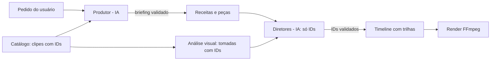
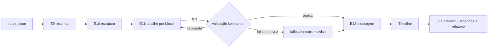

# Arquitetura — AI Video Editor

Para onde o editor está indo e como as partes se encaixam. Opções e comandos estão na [referência técnica](REFERENCIA.md); o porquê de cada decisão, no [histórico](HISTORICO.md).

## 1. Princípio (intocável)

**A IA aponta IDs; o código e o FFmpeg executam.** Nenhum modelo produz timestamps, comandos ou cortes: ele devolve dados estruturados (Pydantic) que referenciam IDs que o código criou (frases da transcrição, clipes do catálogo), e o código valida e executa de forma determinística. Uma resposta inválida é recusada, refeita ou ignorada, mas nunca corrompe o vídeo.

## 2. Hoje: vídeo falado e a espinha falada de uma pasta

O comando `edit <vídeo>` edita um vídeo falado (aula, tutorial, pessoa falando):

```text
probe → silences → transcription → director → plan → render → subtitles → report
```

Cada etapa grava um artefato e um fingerprint em `project.json`; na execução seguinte, etapas com entradas iguais vêm do cache. O Diretor de IA recebe frases numeradas e devolve só os IDs a remover. O `revise` cria novas versões a partir de pedidos em linguagem natural, com a mesma regra.

O comando `edit <pasta>` (receita `vlog`, rodada 2) monta a **espinha falada** de um projeto com vários clipes:

```text
catalog → silences (por clipe) → transcription (por clipe) → director → timeline → render → subtitles → report
```

Os clipes `principal` com fala entram na ordem do catálogo; silêncios e transcrição têm cache por clipe (fora do projeto, chave = hash do arquivo + parâmetros); as frases ganham IDs globais com o `clip_id` (uma frase nunca atravessa dois clipes); o Diretor vê os clipes como seções e ganha a categoria `retake`; os trechos mantidos de cada clipe (mesmo corte do caminho de um vídeo) viram itens de `video_main` numa Timeline, renderizada pelo render da Timeline. O caminho de um vídeo continua no `EditPlan`; a unificação dos dois caminhos fica para depois.

Com a análise visual feita (`visual <pasta>`), a receita `vlog_cobertura` (rodada 3; padrão de `edit <pasta>` quando há `visual.json` e transcrição) acrescenta a **cobertura**:

```text
… → timeline → visual (lê visual.json) → coverage → render → subtitles → report
```

A cobertura é **guiada pelo conteúdo da fala** (seção 4): o **Diretor de cobertura** (IA, duas chamadas) primeiro divide as frases em blocos de assunto e depois escolhe, só por IDs e com **evidências** (o trecho da fala e a tag/descrição da tomada que mostram a mesma coisa), coberturas (frases `S…`–`S…` + tomadas `D001.T05`) e respiros entre os blocos; o código confere as evidências, valida item a item e calcula os segundos. Imagem ruim de verdade (medida em segundos) vira uma sugestão de cobrir, não uma obrigação. Depois o código converte IDs em tempos: coberturas viram `video_overlay` (o áudio da fala continua, com o som ambiente da tomada baixinho em `audio_ambient`) e respiros viram itens de `video_main` inseridos na espinha. Render, legendas, transcrição comparativa, linha do tempo e relatório usam essa Timeline final; `--so-plano` para antes do render e mostra o plano por bloco.

## 3. Peças e receitas

- **Peça** = uma etapa que o código sabe executar (`recipes/schema.py: PIECES`): `probe`, `silences`, `transcription`, `director`, `plan`, `render`, `subtitles`, `report`. Cada peça declara o que sempre exige antes dela (ex.: `director` precisa de `transcription`).
- **Receita** = uma combinação validada de peças (`Recipe`: nome, descrição, etapas em ordem e dependências). Validar uma receita recusa etapa desconhecida, etapa repetida, dependência faltando e ordem impossível (inclusive circular), com uma mensagem em português dizendo o que corrigir.
- Peças: `catalog`, `probe`, `silences`, `transcription`, `director`, `plan`, `timeline`, `visual`, `coverage`, `render`, `subtitles`, `report`. O que só vale em uma receita (ex.: `render` depois de `plan` na `fala`, depois de `timeline` na `vlog`) fica nos `requires` da receita. O campo `multi_clip` diz se a receita trabalha com vários clipes de uma pasta (o Produtor e a CLI usam para casar receita e material).
- O `EditPipeline` recebe a receita (padrão `fala`) e executa as etapas na ordem dela; o `SpinePipeline` faz o mesmo com a `vlog` sobre uma pasta; a numeração `[4/8] Diretor` também vem dela. A receita `fala` é exatamente o `edit` de hoje, com os mesmos fingerprints, cache e saída. Um teste de referência (`tests/test_reference_fala.py`) garante isso.
- Receitas são **dados**: quem escolhe uma receita, seja o usuário (`edit --receita`) ou o Produtor, nunca inventa um processo. Ele só escolhe receitas existentes e ajusta os parâmetros das peças.

## 4. Visão: todo trabalho é um projeto com clipes

O editor deixa de ser só de vídeos falados e passa a editar qualquer tipo de vídeo.

- **Projeto com clipes.** Um vídeo único é um projeto de 1 clipe; uma pasta é um projeto de N clipes (ex.: vlog com subpastas `principal/`, `drone/`, `pov/`, `broll/`). O **catálogo** (`catalog <pasta>`) é a porta de entrada: cada clipe ganha um papel (pela subpasta), um ID estável (`P001`, `D001`, `V001`, `B001`, `X001`), dados técnicos, data de gravação com origem, detecção de fala, sinais simples de cor e miniaturas. É o vocabulário de IDs que as IAs vão usar.
- **Pedido do usuário.** O usuário descreve o que quer (`--pedido`).
- **Produtor (IA; comando `briefing`, rodada 2).** Lê o pedido e um resumo do catálogo (por papel: quantidade, duração, fala, formatos; nunca a lista de clipes) e devolve um **briefing**: tipo de vídeo, uma receita registrada, "Entendi: ...", metas (duração, intensidade, ritmo), instruções para o Diretor de cortes e para o de cobertura, papéis a usar. O código valida o briefing contra o registro de receitas (lido na hora) e o material (receita de 1 vídeo com vários clipes falados, receita de fala sem fala, papéis e duração alvo); inválido → nova tentativa com o erro → fallback determinístico registrado. O Produtor escolhe e ajusta, nunca cria etapas. **Implementado** como comando (`briefing <arquivo-ou-pasta>`, salva `briefing.json`) e no `edit`: com `--pedido`, o `edit` reaproveita o `briefing.json` do mesmo pedido e material ou roda o Produtor; receita, intensidade, ritmo, instruções ao Diretor e duração alvo vêm do briefing quando a CLI não as dá (CLI > briefing > padrão, origem registrada no `project.json` e no relatório); `--sem-briefing` desliga.
- **Análise visual (`visual`, rodada 2).** Cada clipe vira **tomadas** (`P007.T03`: mudança de cena ou janela de até 8 s), com 3 miniaturas (`P007.T03.F1..F3`) e medidas sem IA (desfoque, brilho, movimento, tela uniforme). Uma IA multimodal descreve as tomadas em lotes vendo só miniaturas rotuladas com IDs: descrição, tags, rosto, problemas, se é utilizável, o melhor trecho (por IDs de miniatura) e a beleza como cobertura. Os tempos ficam no código. É o vocabulário visual dos Diretores de cobertura, e a seção "Atenção" já aponta a fala com imagem ruim.
- **Diretores especializados.** O Diretor de fala decide por IDs de frases; o **Diretor de cobertura** (rodada 3, módulo `coverage/`) decide por IDs de frases e tomadas, com evidências, qual B-roll/drone/POV cobre qual trecho da fala e onde entram respiros. Os próximos (música, transições) seguem o mesmo molde: o código cria os IDs, valida e converte em tempos.
- **Cobertura pelo conteúdo da fala.** A imagem de cobertura existe para **mostrar o que é dito** (fala do lago → imagem do lago) ou o lugar onde a cena acontece; sem imagem que combine, a pessoa continua na tela. Na primeira versão (rodada 3) a cobertura nascia dos defeitos de imagem ("janelas obrigatórias") e da beleza das tomadas, e no vlog real isso cobriu de drone a mulher falando no ônibus e o tour inteiro pelo quarto do hotel (59 s) quando o defeito eram ~14 s. Agora:
  1. **A IA entende o vídeo** (1ª chamada): do que ele trata e os **blocos de assunto** (frases seguidas no mesmo lugar/momento: chegada de ônibus, quarto do hotel, trilha até o lago). O código valida o mapa inteiro (contíguo, sem buraco nem sobreposição); inválido, um bloco por clipe.
  2. **A IA escolhe com evidência** (2ª chamada, vendo as frases dentro dos blocos, o que está na tela, quem fala para a câmera e as candidatas com descrição e tags): cada cobertura cita um trecho **literal** da fala e uma **tag ou trecho da descrição** da tomada, e as duas precisam falar da mesma coisa. O código confere tudo (sem diferenciar acentos, com plural e uma tabela pequena de sinônimos) e descarta o item sem evidência, com o motivo. Na dúvida, não cobre.
  3. **O código decide os segundos:** a imagem fica perto de quando a coisa é dita (encurtar, nunca completar com tomada que a IA não escolheu); a pessoa falando para a câmera só é tapada com evidência forte (a coisa falada é tag da tomada); a cobertura soma no máximo 30% do vídeo.
  4. **Imagem ruim vira sugestão:** o código mede os segundos ruins de verdade (parte mantida da fala ∩ tomadas graves, com margem pequena) e diz à IA "prefira cobrir aqui se houver imagem que combine"; a cobertura ali fica limitada a esses segundos, e sem imagem que combine a imagem original fica, com aviso. Só a tela uniforme (parede, câmera tapada) é tapada sem evidência de fala, com tomada relacionada (gravada perto ou com tags em comum) e só pelo tempo dela.
  5. **Respiros só entre blocos de assunto**, com uma tomada que tenha relação com o bloco vizinho.
  6. **Legível:** uma linha por bloco (`S034–S041 · trilha até o lago · coberto 2× (D001.T10 'lago' ↔ 'lago escuro entre montanhas')`, `S000–S012 · chegada de ônibus · sem cobertura (nenhuma imagem de ônibus)`) no terminal, no relatório e no `coverage_plan.md`; `edit --so-plano` mostra o plano sem renderizar.
- **Timeline com trilhas.** Substitui o `EditPlan` (lista única de trechos) por trilhas: fala principal, cobertura de vídeo, áudio. Já existe (`core/timeline.py`, executada pelo comando `render`); o `edit <pasta>` já a gera (espinha em `video_main`; com cobertura, também `video_overlay`, respiros na base e ambiente); o `edit <vídeo>` ainda usa o `EditPlan`. O áudio da Timeline sai de um único FFmpeg, qualquer que seja o número de cortes.



### Nova direção: o programa mede, a IA decide (roteiro unificado)

O editor deve funcionar para **qualquer tipo de vídeo**. Para isso a divisão de trabalho fica explícita: **o programa só mede, descreve, confere e executa; a IA toma as decisões de edição.** Nenhuma regra do código depende de um papel específico (principal, drone, POV, b-roll...) ou do tipo "vlog": o papel e "tem fala/não tem" são informação para a IA. Um arquivo é um projeto de 1 clipe; uma pasta com várias câmeras é um projeto com vários papéis.

Fluxo do **Editor de IA**:

```text
catálogo → silêncios → transcrição → frases + ritmo → fotos → descrições (IA de visão local) → momentos → ROTEIRO UNIFICADO
        → E9 resumos por clipe (IA, 1 pedido/clipe) → E10 estrutura (IA, 1 pedido: blocos, fora, acervo, alvos)
        → E11 detalhe por bloco (IA, 1 pedido/bloco ou pedaço: manter, coberturas, respiros)
        → E12 montagem por IDs (código: validação + IDs → tempos → Timeline) → E13 render, legendas, relatório
```



- **Roteiro unificado (`roteiro <arquivo-ou-pasta>`, feito):** por clipe, os **momentos** (`P007.M04`: fotos seguidas com a mesma imagem, descritas por uma IA de visão local — Gemma 3 4B via Ollama, ou qualquer provedor da camada `llm/`), as **frases** (`S012`, com volume, velocidade e pausas medidos pelo programa) ligadas aos momentos que atravessam, problemas de imagem e medidas. Todo clipe entra, com ou sem fala. Tempos ficam no JSON; o texto (`roteiro.md`) mostra mm:ss só como contexto e traz o tamanho estimado em tokens, total e por clipe, para dimensionar o diretor.
- **Editor de IA em passadas (`edit --receita editor_ia`, feito):** a IA lê o roteiro em três passadas e responde só com IDs; o código não tem regra editorial. **E9** resume cada clipe (resumo, destaques, problemas, tom). **E10** vê os resumos + uma linha por clipe e decide a estrutura: blocos em ordem (clipes, título, duração alvo), clipes fora (com motivo) e o resto como acervo de cobertura/respiros. **E11** recebe, por bloco, as seções do roteiro dos clipes do bloco, a continuidade do bloco anterior e o acervo pré-selecionado por tags em comum, e decide o que fica (faixas de frases ou momentos), as coberturas (com a palavra da fala e da imagem que as justificam) e os respiros. O código valida cada item (IDs existentes, do bloco, sem repetir nem sobrepor, evidência presente), pede de novo com a lista de erros e, se falhar de vez, usa um **fallback neutro** (um bloco por clipe com fala; no bloco, todas as frases) com aviso — nunca uma escolha "de bom gosto" do código. **Orçamento de contexto:** tudo é medido em tokens estimados contra o `num_ctx` do modelo local (8192 por padrão); bloco que não cabe é dividido em pedaços em ordem, nunca truncado. **E12** converte os IDs em tempos com o mesmo corte por palavra/silêncio do `edit` e monta a Timeline com trilhas; **E13** renderiza, legenda e escreve `editor_plano.md` e `editor_relatorio.md`. Cada resposta aceita fica em cache por passada (mudar o pedido de uma passada não refaz as outras).
- **Até o editor novo provar que é melhor**, as receitas `vlog`/`vlog_cobertura` e o comando `visual` ficam como estão (o roteiro e o editor só reaproveitam os caches e as funções deles), e o Produtor não oferece a `editor_ia` (só com `--receita editor_ia`).

## 5. Plano de rodadas

Cada rodada tem tarefas em paralelo (um worktree por tarefa):

1. **Catálogo + receitas** ∥ **Timeline + render.** Catálogo de pastas de clipes, receitas como dados (`fala` = o `edit` atual), teste de referência do perfil falado; em paralelo, a Timeline com trilhas e o render dela.
2. **Produtor** ∥ **espinha falada multiclipe** ∥ **análise visual.** Briefing a partir do pedido + catálogo; a receita de fala sobre vários clipes principais em sequência (IDs de frase passam a incluir o clipe); análise visual dos clipes (tomadas, miniaturas, medidas e descrição por IA — feita: comando `visual`) para os Diretores visuais. ✅ Espinha pronta: `edit <pasta>` (receita `vlog`), com os principais sem fala listados como disponíveis para a cobertura.
3. **Diretor de cobertura** + **render com cobertura.** B-roll/drone/POV cobrindo trechos da fala, por IDs de clipes e de frases. ✅ Feita: receita `vlog_cobertura` (peças `visual` e `coverage`), Diretor de cobertura (gemini/openai/mock) com validação, nova tentativa e fallback, coberturas em `video_overlay`, respiros na base e ambiente; legendas e relatórios na Timeline final. Depois, cobertura pelo conteúdo da fala (mapa de assuntos, evidências conferidas, imagem ruim como sugestão, `--so-plano`).
4. **`revise` multitrilha** + **relatórios.** Pedidos em linguagem natural sobre a Timeline inteira, e relatórios/linha do tempo por trilha.
5. **Editor de IA (nova direção, seção 4).** ✅ Roteiro unificado (comando `roteiro`: fotos, descrição por IA de visão local, ritmo, momentos, IDs). ✅ Editor de IA em passadas (receita `editor_ia`: resumos, estrutura, detalhe por bloco com orçamento de contexto, montagem por IDs, render). Próximo: rodar com o Qwen local no vlog real (`--so-plano` primeiro), calibrar `TOKEN_FACTOR` e os pedidos, e comparar com `vlog_cobertura` antes de trocar o padrão.
