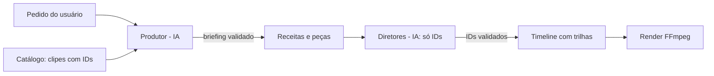

# Arquitetura — AI Video Editor

Para onde o editor está indo e como as partes se encaixam. Opções e comandos estão na [referência técnica](REFERENCIA.md); o porquê de cada decisão, no [histórico](HISTORICO.md).

## 1. Princípio (intocável)

**A IA aponta IDs; o código e o FFmpeg executam.** Nenhum modelo produz timestamps, comandos ou cortes: ele devolve dados estruturados (Pydantic) que referenciam IDs que o código criou (frases da transcrição, clipes do catálogo), e o código valida e executa de forma determinística. Uma resposta inválida é recusada, refeita ou ignorada, mas nunca corrompe o vídeo.

## 2. Hoje: o perfil de vídeo falado

O comando `edit` edita um vídeo falado (aula, tutorial, pessoa falando):

```text
probe → silences → transcription → director → plan → render → subtitles → report
```

Cada etapa grava um artefato e um fingerprint em `project.json`; na execução seguinte, etapas com entradas iguais vêm do cache. O Diretor de IA recebe frases numeradas e devolve só os IDs a remover. O `revise` cria novas versões a partir de pedidos em linguagem natural, com a mesma regra.

## 3. Peças e receitas

- **Peça** = uma etapa que o código sabe executar (`recipes/schema.py: PIECES`): `probe`, `silences`, `transcription`, `director`, `plan`, `render`, `subtitles`, `report`. Cada peça declara o que sempre exige antes dela (ex.: `director` precisa de `transcription`).
- **Receita** = uma combinação validada de peças (`Recipe`: nome, descrição, etapas em ordem e dependências). Validar uma receita recusa etapa desconhecida, etapa repetida, dependência faltando e ordem impossível (inclusive circular), com uma mensagem em português dizendo o que corrigir.
- O `EditPipeline` recebe a receita (padrão `fala`) e executa as etapas na ordem dela; a numeração `[4/8] Diretor` também vem dela. A receita `fala` é exatamente o `edit` de hoje, com os mesmos fingerprints, cache e saída. Um teste de referência (`tests/test_reference_fala.py`) garante isso.
- Receitas são **dados**: quem escolhe uma receita, seja o usuário (`edit --receita`) ou o Produtor, nunca inventa um processo. Ele só escolhe receitas existentes e ajusta os parâmetros das peças.

## 4. Visão: todo trabalho é um projeto com clipes

O editor deixa de ser só de vídeos falados e passa a editar qualquer tipo de vídeo.

- **Projeto com clipes.** Um vídeo único é um projeto de 1 clipe; uma pasta é um projeto de N clipes (ex.: vlog com subpastas `principal/`, `drone/`, `pov/`, `broll/`). O **catálogo** (`catalog <pasta>`) é a porta de entrada: cada clipe ganha um papel (pela subpasta), um ID estável (`P001`, `D001`, `V001`, `B001`, `X001`), dados técnicos, data de gravação com origem, detecção de fala, sinais simples de cor e miniaturas. É o vocabulário de IDs que as IAs vão usar.
- **Pedido do usuário.** O usuário descreve o que quer (`--pedido`).
- **Produtor (IA, rodada 2).** Lê o pedido e o catálogo e devolve um **briefing**: quais receitas e etapas rodar, quais Diretores, metas (duração, ritmo, foco). O código valida o briefing contra o registro de receitas e peças. O Produtor escolhe e ajusta, nunca cria etapas.
- **Diretores especializados.** O Diretor de fala (o de hoje) decide por IDs de frases; os próximos decidem por IDs de clipes e trechos (ex.: Diretor de cobertura: qual B-roll cobre qual trecho da fala).
- **Timeline com trilhas.** Substitui o `EditPlan` (lista única de trechos) por trilhas: fala principal, cobertura de vídeo, áudio. Está em andamento em paralelo (worktree `timeline-render`), junto com o render que a executa.



## 5. Plano de rodadas

Cada rodada tem tarefas em paralelo (um worktree por tarefa):

1. **Catálogo + receitas** ∥ **Timeline + render.** Catálogo de pastas de clipes, receitas como dados (`fala` = o `edit` atual), teste de referência do perfil falado; em paralelo, a Timeline com trilhas e o render dela.
2. **Produtor** ∥ **espinha falada multiclipe** ∥ **análise visual.** Briefing a partir do pedido + catálogo; a receita de fala sobre vários clipes principais em sequência (IDs de frase passam a incluir o clipe); análise visual dos clipes (proxies, descrição de cena) para os Diretores visuais.
3. **Diretor de cobertura** + **render com cobertura.** B-roll/drone/POV cobrindo trechos da fala, por IDs de clipes e de frases.
4. **`revise` multitrilha** + **relatórios.** Pedidos em linguagem natural sobre a Timeline inteira, e relatórios/linha do tempo por trilha.
